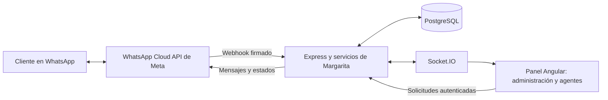

<p align="center">
  
</p>

<h1 align="center">Margarita</h1>

<p align="center">
  Operación de WhatsApp Business para equipos que necesitan atender, organizar y dar seguimiento desde un solo lugar.
</p>

<p align="center">
  <strong>Bandeja compartida · Automatización opcional · WhatsApp Business Cloud API</strong>
</p>

---

## Qué es

Margarita es una aplicación web de atención por WhatsApp. Reúne en una bandeja las conversaciones que llegan al número de WhatsApp Business de una empresa y permite que varias personas del equipo las atiendan con contexto, reglas y seguimiento.

El equipo puede responder manualmente, usar respuestas rápidas y plantillas aprobadas por Meta, distribuir conversaciones y, si lo configura, apoyarse en automatizaciones con IA o flujos guiados.

> **En una frase:** Margarita convierte el WhatsApp de una empresa en un canal de atención compartido, medible y operable por un equipo.

## Cómo se usa

1. **Conectar el canal.** Se configura una cuenta de WhatsApp Business Cloud API y uno o más números empresariales.
2. **Preparar el equipo.** Un administrador invita agentes, define horarios y ajusta respuestas rápidas, plantillas, etiquetas y automatizaciones.
3. **Atender.** Los mensajes entrantes aparecen en la bandeja; el equipo asigna y responde desde Angular, con actualizaciones en vivo.
4. **Dar seguimiento.** Margarita conserva el historial y los estados que comunica Meta, registra actividad y permite revisar reportes y operación.

### Ejemplo de jornada

Una persona escribe al WhatsApp de la empresa. Margarita recibe el aviso de Meta, encuentra o crea el contacto y muestra la conversación a los agentes. Un agente la toma, consulta el historial y responde. Si el mensaje requiere una plantilla aprobada, la envía desde el mismo flujo. Cuando termina, el hilo puede cerrarse; si requiere seguimiento humano, queda asignado al equipo.

## Funciones principales

| Área | Qué permite hacer |
| --- | --- |
| **Conversaciones** | Bandeja para administración y agentes, asignación, toma de conversaciones, notas internas, estados y actualizaciones en vivo. |
| **Atención por WhatsApp** | Texto, archivos multimedia, plantillas de Meta, respuestas rápidas de texto, botones y listas, reacciones, leído y escribiendo. |
| **Contactos** | Fichas, etiquetas, notas, consentimiento declarado y bajas. Se puede bloquear o desbloquear un contacto en WhatsApp desde la conversación. |
| **Campañas** | Preparar envíos a grupos de contactos con plantillas aprobadas, variables y control de cola, pausa y reintentos. |
| **Automatización** | Flujos guiados y funciones opcionales de IA para sugerir o enviar respuestas dentro de los controles configurados, con entrega al equipo cuando corresponde. |
| **Administración** | Equipo, números, perfil y salud reportada por Meta, reportes, bitácora, sesiones, respaldos y configuración. |

Las operaciones de leído y escribiendo se envían desde Margarita cuando el agente abre o atiende una conversación; **no indican que el cliente esté escribiendo en WhatsApp**. La disponibilidad de funciones puede depender de las capacidades de Meta y la configuración del número.

## Para quién es

- Equipos de servicio al cliente que comparten un número de WhatsApp.
- Negocios que reciben solicitudes, preguntas, reservaciones, pedidos o consultas de seguimiento.
- Operaciones que necesitan distribuir conversaciones entre agentes y conservar un historial común.
- Empresas que quieren usar plantillas aprobadas para avisos y campañas, con control operativo del equipo.

Margarita es una herramienta de operación de mensajería, no un CRM integral. No crea ni aprueba plantillas de Meta y no verifica por sí sola que cada contacto haya dado consentimiento. WhatsApp y sus cargos se administran bajo las reglas y la cuenta de Meta del negocio.

## Cómo funciona técnicamente



- **Frontend:** panel Angular en `frontend/`, servido por Express bajo `/panel`.
- **Servidor:** Node.js, TypeScript y Express. Mantiene sesiones, permisos, validación, reglas del producto y llamadas a Meta.
- **Datos:** PostgreSQL con Prisma y migraciones versionadas.
- **Tiempo real:** Socket.IO actualiza conversaciones y contadores del panel.
- **Canal:** webhooks de Meta ingresan mensajes y estados; Margarita valida la firma y procesa eventos de forma idempotente.
- **Archivos:** medios y respaldos usan el almacenamiento configurado para el entorno; producción requiere almacenamiento persistente.

Angular es el panel autenticado habitual; el repositorio conserva vistas EJS activas para el asistente de configuración, ciertas páginas públicas y de acceso, y compatibilidad explícita con vistas anteriores. La página comercial en `landing/` y la demo de ventas son componentes independientes del panel operativo.

## Venta y puesta en marcha

La propuesta comercial puede centrarse en el resultado operativo: **un solo canal compartido, conversaciones asignables, respuestas consistentes y visibilidad para quien coordina el equipo**. IA y campañas son capacidades opcionales; la operación manual sigue siendo el núcleo.

Para ponerlo en marcha, el negocio necesita:

1. Una cuenta y un número compatibles con WhatsApp Business Cloud API, configurados en Meta.
2. Un entorno de Margarita con dominio HTTPS, base PostgreSQL, secretos y almacenamiento persistente.
3. Un administrador que complete `/setup`, conecte las credenciales y configure el webhook.
4. Plantillas aprobadas por Meta para los casos de uso que las requieran; reglas de consentimiento y bajas definidas por el negocio.
5. Agentes invitados y un proceso de atención acordado: asignación, horarios, escalamiento y uso de automatizaciones.

Los cargos de WhatsApp/Meta, infraestructura y proveedores de IA son externos a Margarita y dependen de las cuentas y configuración del cliente. No se deben presentar como incluidos en una licencia sin validarlo comercialmente.

## Desarrollo local

Se requiere Node.js según `.nvmrc` y PostgreSQL. Para iniciar:

```sh
npm ci
cp .env.example .env
npm run dev
```

Configura primero `DATABASE_URL`, los secretos de aplicación y cifrado. En una instalación vacía, completa el asistente en `/setup`. Para compilar toda la aplicación:

```sh
npm run build
```

| Comando | Uso |
| --- | --- |
| `npm run dev` | Servidor local con recarga |
| `npm run frontend:build` | Compilación del panel Angular |
| `npm test` | Pruebas unitarias |
| `npm run test:integration` | Pruebas con base de datos desechable |
| `npx tsc --noEmit` | Verificación de tipos del servidor |
| `npm run build` | Prisma, frontend, estilos, servidor y recursos |
| `npm run landing:build` | Generación del sitio estático de producto |

## Seguridad y operación

- Toma `.env.example` como referencia; nunca subas credenciales, datos reales o respaldos al repositorio.
- Margarita cifra campos sensibles en reposo. `ENCRYPTION_KEY` debe conservarse y respaldarse de forma segura.
- Verifica el webhook, usa HTTPS y revisa las migraciones antes de publicar cambios de esquema.
- En Railway, configura volúmenes persistentes para los archivos y respaldos que deban sobrevivir a un despliegue.
- Las pruebas de integración deben usar una base y secretos de prueba, nunca producción.

## Documentación

- [Alcance de producto y producción](docs/alcance-produccion.md): capacidades, arquitectura, uso, límites y operación.
- [Panel Angular](frontend/README.md)
- [Configuración de entorno](.env.example)
- [Modelo de datos](prisma/schema.prisma)
