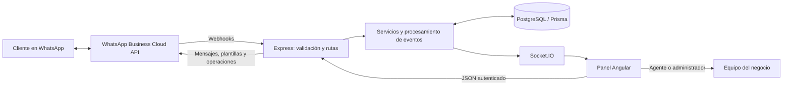

# Margarita | Alcance de producto y producción

> **Propósito del documento**
> Explicar qué resuelve Margarita, qué incluye su implementación, cómo se usa y qué condiciones técnicas requiere. Sirve como base para presentar el producto, calificar oportunidades comerciales y preparar una puesta en marcha.

**Revisión del repositorio:** 23 de noviembre de 2026.
El código describe capacidades; la disponibilidad concreta depende de las cuentas de Meta, configuración e infraestructura de cada instalación.

---

## 1. Resumen del producto

Margarita es una consola web para que una empresa y su equipo administren la atención que ocurre en su WhatsApp Business. Recibe conversaciones por WhatsApp Business Cloud API, organiza contactos y conversaciones, permite responder desde una bandeja compartida y ofrece herramientas de seguimiento, campañas y automatización.

Su valor principal es operativo: **el equipo trabaja desde un historial común, sabe quién atiende cada conversación y puede aplicar respuestas y procesos consistentes**. La operación manual es el centro; IA, flujos y campañas complementan el trabajo cuando el negocio los necesita.

### Presentación breve

> “Margarita reúne el WhatsApp de tu empresa en una bandeja para todo el equipo. Permite asignar conversaciones, responder con contexto, usar plantillas y automatizaciones configuradas y revisar la operación desde un panel.”

## 2. Cliente y casos de uso

### Perfil de cliente adecuado

- Negocio que atiende clientes por WhatsApp y necesita que más de una persona comparta la operación.
- Equipo que quiere centralizar historial y asignación en vez de depender de un teléfono o una sola persona.
- Organización que envía notificaciones o campañas autorizadas usando plantillas aprobadas.
- Operación que desea automatizar preguntas y pasos repetitivos, manteniendo la posibilidad de pasar la conversación a un agente.

### Ejemplos de uso

| Necesidad | Uso posible en Margarita |
| --- | --- |
| Solicitudes y preguntas | Recibir mensajes, asignarlos a un agente y responder desde la conversación compartida. |
| Reservas o citas | Atender solicitudes y enviar avisos con una plantilla aprobada cuando las reglas de Meta lo requieran. |
| Pedidos y seguimiento | Consultar el hilo, registrar notas internas y dar continuidad entre personas del equipo. |
| Atención de varias sucursales o servicios | Administrar más de un número empresarial; la autorización y la vista siguen las reglas actuales de la instalación, no permisos configurables por número. |
| Consultas repetitivas | Configurar respuestas rápidas, flujos deterministas o IA opcional, con entrega a una persona según las reglas establecidas. |

Los ejemplos describen patrones de uso, no integraciones con sistemas de reservas, pagos, inventario o CRM que no estén implementadas/configuradas en el proyecto.

## 3. Recorrido diario de operación

1. Una persona escribe al número de WhatsApp Business del negocio.
2. Meta envía el evento al webhook configurado en Margarita.
3. Margarita verifica el evento, evita duplicar el mismo mensaje y actualiza contacto e hilo.
4. La conversación aparece en la bandeja; el equipo recibe actualización en vivo y puede reclamarla o asignarla.
5. El agente revisa el historial y responde con texto, medios, plantilla o respuesta rápida. Acciones compatibles pueden marcar lectura o mostrar que el agente está escribiendo. Desde la bandeja puede enviar una plantilla aprobada a varias conversaciones seleccionadas, con un máximo de 25 y variables compartidas. Las etiquetas activas del contacto se muestran en cada fila y pueden usarse para filtrar la bandeja antes de seleccionar.
6. Meta devuelve estados de envío y entrega, que Margarita incorpora al historial.
7. El equipo cierra o continúa el hilo y consulta actividad y reportes cuando necesita supervisar la atención.

El indicador de “escribiendo” comunica que el **agente de Margarita** está preparando una respuesta. No informa que el cliente esté escribiendo. La función de leído/escribiendo se activa desde la operación en Margarita y depende de que el mensaje y la API permitan esa acción.

## 4. Alcance funcional

### Bandeja compartida

- Panel Angular para administradores y agentes, con conversaciones y actualizaciones en vivo.
- Asignación, reclamación, cierre y reapertura conforme a las reglas del servidor.
- Historial, mensajes internos, estados de entrega, reacciones, opciones de leído/escribiendo y archivos multimedia compatibles.
- Indicador de no leídos en la pestaña del navegador y preferencias individuales de sonido.
- Respuestas rápidas de texto, botones (hasta 3) y listas (hasta 10 opciones); el envío está sujeto a límites/configuración de WhatsApp.
- Uso de mensajes de texto libre sujeto a la ventana de atención de 24 horas. Fuera de ella, se requiere una plantilla aplicable y aprobada.

### Contactos y campañas

- Fichas de contacto, etiquetas, notas, consentimiento declarado y registro de bajas.
- Bloqueo y desbloqueo en WhatsApp desde la conversación, con estado visible para el equipo. Es independiente de la baja interna.
- Campañas mediante contactos o importaciones, variables, programación y controles de cola, pausa y reintento.
- Envíos de plantilla sujetos a aprobación, reglas y límites de Meta; la aplicación no garantiza que Meta acepte o entregue cada mensaje.

### Automatización

- Flujos guiados basados en reglas configuradas por el equipo.
- IA opcional como sugerencias o respuestas automáticas, condicionada por la configuración de proveedor, conocimiento, controles, límites y presupuesto.
- Posibilidad de transferir la conversación a una persona según reglas de atención.

La IA no equivale a un agente autónomo de propósito general. No se debe vender como sistema que toma decisiones comerciales fuera de los límites configurados.

### Administración y supervisión

- Usuarios y roles, configuración del espacio de trabajo, números y sincronización de plantillas.
- Perfil empresarial, información de salud del número y usuarios bloqueados según la API de Meta.
- Reportes, bitácora, gestión de sesiones, respaldos y controles operativos disponibles en el panel.
- Métricas de costos configurables son estimaciones operativas; la facturación oficial de WhatsApp corresponde a Meta.

## 5. Arquitectura técnica



| Componente | Responsabilidad |
| --- | --- |
| Angular (`frontend/`) | Interfaz autenticada habitual del equipo bajo `/panel`; consume rutas JSON. |
| Node.js, TypeScript y Express (`src/`) | Sesiones, permisos, validaciones, reglas de negocio, endpoints y conexión con Meta. |
| PostgreSQL y Prisma (`prisma/`) | Persistencia, esquema y migraciones versionadas. |
| Webhooks de Meta | Entrada de mensajes y eventos de estado; firma verificada y procesamiento con deduplicación. |
| Socket.IO | Cambios en vivo en conversaciones y contadores del panel. |
| Almacenamiento de medios y respaldos | Archivos locales en rutas configuradas o almacenamiento externo compatible; en producción necesita persistencia y política de retención. |

### Frontend en producción

Angular es el panel principal. EJS **continúa activo** para el asistente de configuración, ciertas páginas públicas/de acceso y rutas explícitas de compatibilidad con pantallas anteriores. Las plantillas archivadas en `src/views/legacy-unused/` no se renderizan. El sitio de producto en `landing/` y la demo comercial son proyectos/servicios separados del panel y sus datos de clientes.

### Despliegue

La aplicación se puede desplegar como servicio web Node.js con PostgreSQL; Railway es una opción usada por el proyecto. Para una instalación productiva deben configurarse por separado dominio HTTPS, variables, base de datos, volúmenes, credenciales de Meta, webhook y observabilidad. El nombre del proveedor no sustituye la verificación de la configuración real.

## 6. Límites y condiciones comerciales

| Tema | Alcance real |
| --- | --- |
| Modelo de instalación | Una empresa/espacio de trabajo por instalación. No es una plataforma multiempresa aislada dentro de una única instancia. |
| WhatsApp | Requiere cuenta, número y credenciales de WhatsApp Business Cloud API administrados con Meta. |
| Plantillas | Margarita sincroniza y utiliza plantillas; Meta las crea, revisa, aprueba y puede reclasificar. |
| Consentimiento | El equipo puede registrar consentimiento y bajas. Margarita no comprueba por sí misma la validez de la autorización del destinatario. |
| Costos | Cargos de WhatsApp/Meta, alojamiento y proveedores de IA son externos y dependen de las cuentas y uso del cliente. |
| CRM e integraciones | No se debe ofrecer como CRM completo ni prometer sincronizaciones con ERP, pagos, reservas o inventarios que no estén implementadas. |
| Permisos por número | Roles de administración y agente aplican a la instalación; no hay una matriz configurable de acceso para cada número. |
| Entrega | El estado refleja lo informado por Meta; no garantiza que un proveedor acepte, entregue o muestre cada mensaje. |

## 7. Seguridad, datos y continuidad

- PostgreSQL accedido mediante Prisma; los cambios de esquema deben acompañarse de migraciones versionadas.
- Campos sensibles como teléfonos y contenido de mensajes se cifran en reposo; ciertas consultas exactas utilizan índices ciegos.
- La firma del webhook se verifica antes de procesar eventos.
- Sesiones y permisos se controlan en el servidor; hay roles, controles de sesión y segundo factor configurable.
- El acceso a archivos se valida mediante sesión y relación con mensajes de la instalación.
- Medios y respaldos locales deben ubicarse en volumen persistente en producción. El cifrado del respaldo y su restauración periódica deben formar parte de la operación.
- Mantener secretos en variables del entorno, conservar y respaldar `ENCRYPTION_KEY`, activar HTTPS y limitar acceso a volúmenes y cuentas de Meta.

La búsqueda de campos cifrados puede ser exacta y limitada; no equivale a búsqueda parcial de todo el contenido. Los medios que Meta aloja pueden dejar de descargarse pasado su periodo de disponibilidad, por lo que se debe definir una política propia de conservación.

## 8. Preparación de una instalación

### Requisitos de negocio

- Cuenta de Meta Business y configuración de WhatsApp Business Cloud API.
- Número habilitado para el canal y acceso a sus identificadores/tokens.
- Administrador responsable de la cuenta, plantillas, consentimiento, bajas y atención.
- Agentes, horarios, criterios de asignación y proceso de escalamiento definidos.
- Plantillas revisadas/aprobadas por Meta para notificaciones y campañas que las requieran.

### Requisitos técnicos

- Node.js de la versión fijada en `.nvmrc` y PostgreSQL.
- Dominio HTTPS, `APP_URL`, secretos de autenticación/cifrado y variables de Meta.
- URL de webhook accesible y suscripción a los eventos requeridos.
- Volumen persistente para medios y respaldos locales; definir retención, cuota y procedimiento de restauración.
- Proveedor y límites de IA solo si se activan las funciones de IA.

### Secuencia de puesta en marcha

1. Desplegar aplicación y PostgreSQL en entorno de prueba.
2. Configurar variables desde `.env.example` y completar `/setup`.
3. Conectar Meta, verificar webhook y sincronizar los números y plantillas.
4. Crear usuarios, definir horarios, respuestas rápidas, permisos operativos y reglas de atención.
5. Validar recepción, asignación, respuesta dentro/fuera de ventana, medios, estados y notificaciones.
6. Si se habilitan campañas o IA, validar consentimiento, exclusiones, límites, casos de entrega y costos.
7. Configurar respaldos, ejecutar una restauración de prueba y luego habilitar producción.

## 9. Operación y publicación de cambios

Antes de cada publicación:

1. Revisar el diff y las migraciones en una rama de trabajo.
2. Ejecutar las verificaciones adecuadas para el cambio. Para cambios de lógica: pruebas unitarias, tipos y pruebas de integración con una base desechable. Para cambios de interfaz: compilar Angular y revisar las pantallas afectadas.
3. Confirmar las variables y la persistencia del entorno de destino.
4. Desplegar y comprobar acceso al panel, `/health`, webhook, recepción/envío de mensajes y logs.
5. Confirmar el estado del despliegue y probar restauración de respaldos según la política del servicio.

La aplicación incluye endpoints y herramientas operativas, pero la disponibilidad del dominio, volúmenes, variables y despliegue debe confirmarse en Railway u otro proveedor en cada publicación.

## 10. Verificación para desarrollo

```sh
npm test
npx tsc --noEmit
npm run build
npm run test:integration
```

La suite de integración requiere PostgreSQL de pruebas y secretos desechables; nunca debe conectarse a producción. `npm run build` compila los recursos del servidor y el frontend. CI puede incluir controles adicionales de Prisma, seguridad de migraciones y compilación.

## 11. Referencias del repositorio

- Variables y valores predeterminados: `.env.example`, `src/config/app.config.ts`.
- Rutas, permisos y controladores: `src/routes/`, `src/controllers/`.
- Integraciones y reglas: `src/services/`.
- Datos y cambios: `prisma/schema.prisma`, `prisma/migrations/`.
- Aplicación Angular: `frontend/src/app/`, documentación en `frontend/README.md`.
- Vistas activas y archivadas: `src/views/`, `src/views/legacy-unused/`.
